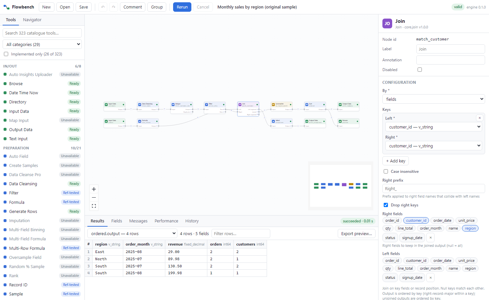

# Flowbench desktop application

Tauri 2 (Rust) shell + React 18/TypeScript UI. The UI never imports engine code: it talks JSON-RPC 2.0 to
`python -m flowengine serve` (stdio sidecar in the desktop build; loopback HTTP + Server-Sent Events in the
browser build used for automated UI tests). Source: `desktop/`.



## Features (all wired to the real engine)

* **Canvas:** drag tools from the palette, typed and labelled input/output anchors, connection rules
  (single vs multi-connection anchors, no self-loops, no cycles), pan/zoom/minimap, box and multi-select,
  containers (group/ungroup, disable), comments, undo/redo, copy/paste/duplicate, navigator, auto-layout for
  documents without positions, live run state per node, row counts on anchors and connections.
* **Palette:** all 323 catalogue entries, search, category filter, "implemented only", status badges derived
  from the evidence ledger (Ready / Ref-tested / Ref-diff / In progress / Unavailable / Blocked) and the reason a
  tool cannot be used.
* **Macro runtimes:** the Macro runtimes palette contains Workflow Macro and Batch Macro. Workflow Macro runs a
  child workflow or relative `.yxmc` definition through typed Macro Input/Output boundaries, including nested
  calls. Batch Macro runs once per ordered control-table record and applies declared updates to existing child
  tool configuration paths; output schemas must match. Native Alteryx Action and Control Parameter XML settings
  are not yet mapped into this runtime.
* **Configuration:** forms generated from each tool's JSON Schema; field pickers per input anchor; expression
  editor with field insertion; Text Input grid; live validation (problems name the node); anchor table;
  incoming/outgoing schema previews; compatibility profile selection.
* **Execution and results:** run (F5), cancel (Esc), rerun; live events; results grid per node/anchor with filter
  and export; field metadata; messages (problems, import report, execution log with node focus); performance
  (per-node durations, wall time, spills); run history (SQLite).
* **Files:** open/save `*.flow.json`; import `.yxmd/.yxmc/.yxwz/.yxzp` (report shown); export `.yxmd` for
  supported tools (lists what cannot be exported).
* **Safety:** workflows containing Python, R or Run Command tools ask for permission before each run.
* **Databases (owner reports installed-app connection and workflow run; remaining acceptance evidence pending):** manage PostgreSQL and SQL Server connections, test them,
  store credentials in the operating-system credential vault, browse metadata, and configure Database Input
  to read a live table or read-only query on each run. Database Output requires a write-enabled connection and
  per-run confirmation. Cross-database joins execute in the Flowbench engine; safe eligible operations may be
  pushed into one database, with executed queries and fallback diagnostics recorded in run evidence.
* **Results export:** the Results grid displays a bounded preview while the engine retains the full result.
  Its file dialogs export the selected complete output or Browse capture as CSV or typed Parquet.

## Keyboard

| Keys | Action |
|---|---|
| F5 / Esc | Run / cancel |
| Ctrl+S, Ctrl+Shift+S, Ctrl+O, Ctrl+N | Save, save as, open, new |
| Ctrl+Z, Ctrl+Y (Ctrl+Shift+Z) | Undo, redo |
| Ctrl+A, Ctrl+C, Ctrl+V, Ctrl+D, Delete | Select all, copy, paste, duplicate, delete |
| Ctrl+G | Group selection in a container |
| Enter on a palette item | Add the tool |

## Build and run

For development from source: Python 3.12 with `pip install -r requirements.txt`, Node 22, Rust (MSVC), and
WebView2. Staging a Windows installer requires Python **3.12.10** exactly. End users of the Windows NSIS
installer do not need a separately installed Python, pip, Node.js, or Rust toolchain: the installer contains the
pinned CPython 3.12.10 runtime and engine dependencies. R is an optional external runtime for R tools and is not
bundled. Code signing is not configured for this internal build.

```powershell
cd desktop
npm ci
npx tauri dev                 # desktop app with hot reload
# for a self-contained Windows installer, first stage pinned CPython and dependencies:
$env:RUNNER_TEMP = Join-Path $env:TEMP 'flowbench-runtime-build'
New-Item -ItemType Directory -Force -Path $env:RUNNER_TEMP | Out-Null
pwsh .\scripts\package_windows_runtime.ps1
npm run tauri -- build         # NSIS installer (src-tauri/target/release/bundle/nsis)
# browser build against a separately started engine:
python -m flowengine serve --http 8765        # from the repository root
npm run dev
```

Windows packaging stages the engine, schemas, catalogue, pinned dependencies, and managed Python runtime under
the Tauri resources. Startup verifies `engine.info` and the 323-entry catalogue over the sidecar RPC channel;
the clean-runner installer CI also executes a deterministic workflow through the installed application before
reinstalling and uninstalling it. See `docs/MILESTONE_2_1_REPORT.md` for the run link and current evidence.

SQL pushdown is conservative. Filter, Select, Summarize, and same-database Join operations can be folded only
when the planner establishes the necessary semantic and consumer constraints. Cross-database Join runs locally;
unsupported expressions/options, fan-out, output-anchor use, ordering, or type/collation differences keep
operations local and produce fallback diagnostics. A translator being able to render SQL does not by itself
mean that a workflow operation was pushed. Consult the run diagnostics/manifest to see what actually executed.

Milestone 2.1 remains **incomplete** pending reviewable evidence for the remaining installed-Tauri PostgreSQL +
SQL Server [manual acceptance workflow](MILESTONE_2_1_MANUAL_ACCEPTANCE.md), including exported-file validation and
the source mutation/rerun. The owner reports that the installed app connected to both fixtures and ran the
configured analysis workflow; this is recorded separately from automated evidence in
[the milestone report](MILESTONE_2_1_REPORT.md). Browser Playwright and engine integration results do not replace
the installed desktop demonstration.

## Tests

* `npx vitest run`: model conversion, undo/redo, connection rules, grouping, run-result guards, status labels,
  CSV export (10 tests).
* `npx playwright test app.spec`: 11 end-to-end scenarios against the real engine: palette honesty,
  building/configuring/connecting/running from scratch, validation feedback, the example workflow with golden
  output, undo/redo/grouping, cancellation, save/reopen round trip, `.yxmd` import, code-tool permission.
* `cargo test` (src-tauri): sidecar protocol parsing and a real engine round trip.
